Backend: https://techstore-api-xb0d.onrender.com  
Aplicación web: https://techstore-lab10-fbrzz004.netlify.app  
Repositorio: https://github.com/fbrzz004/lab10_techstore

Curso: Taller de construcción de software móvil  
Profesor: Dr. Ivan Petrlik Azabache  
Estudiante: André Fabrizzio Román Suyo  
Código: 22200098

## Implementación

- Backend (backend_techstore): Flask 3.1.3, Flask-CORS 6.0.5 y SQLite 3.
- Backend con MVC: modelos de datos, vistas JSON y controladores de rutas.
- Aplicación (app_flutter): Flutter 3.38.8, Dart 3.10.7, Provider 6.1.2 y http 1.2.1.
- Aplicación con arquitectura limpia: capas de dominio, datos y presentación.
- Patrón MVVM: modelos de vista con notificadores de cambios.
- Contraseñas: valor hash calculado con Werkzeug.

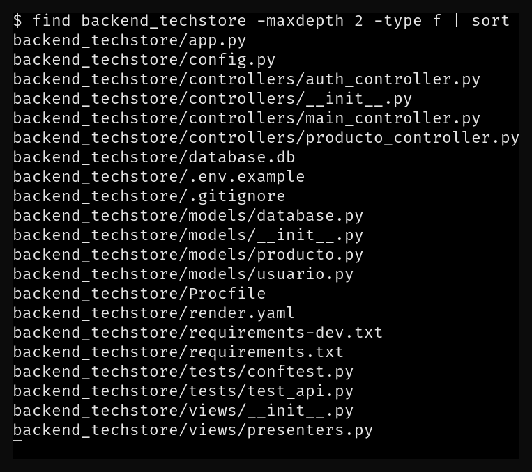{width=13cm}

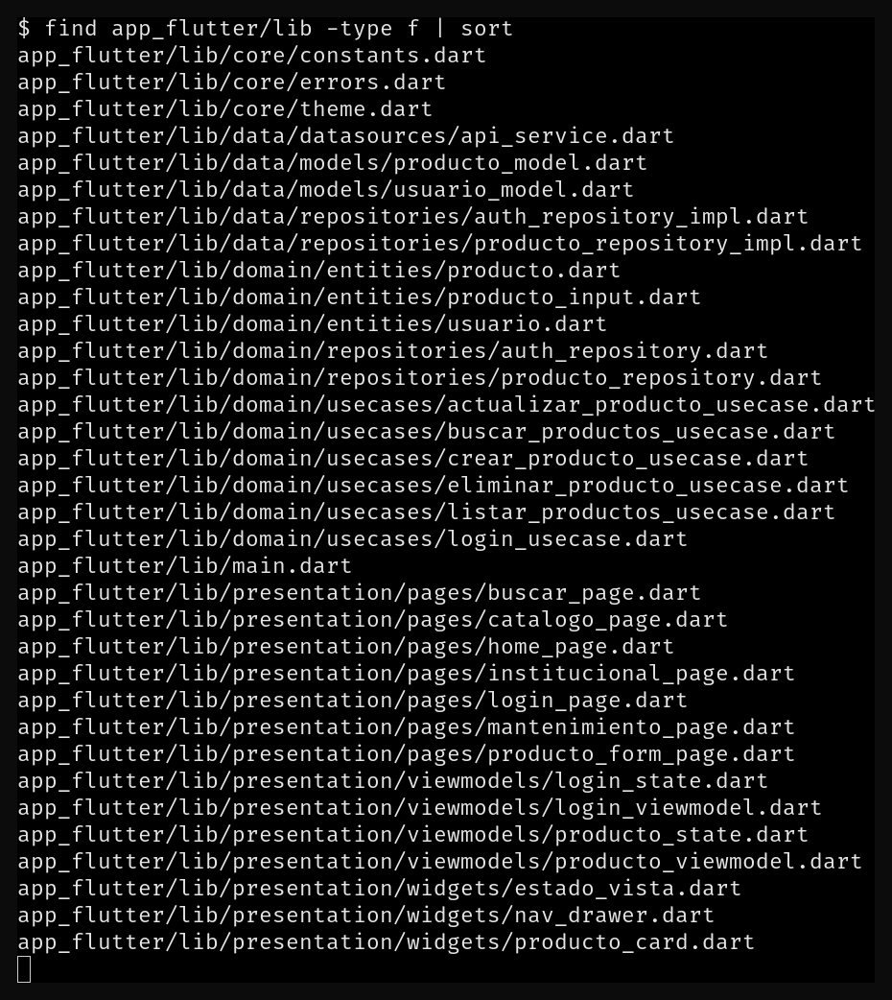{width=13cm}

## Base de datos

| Tabla | Campos |
| --- | --- |
| usuario | id, username, password, nombre, activo |
| producto | id, codigo, nombre, categoria, precio, stock, descripcion |

Datos iniciales: 2 usuarios y 8 productos. La base de datos incluye el producto PROD-009 de la prueba de registro.

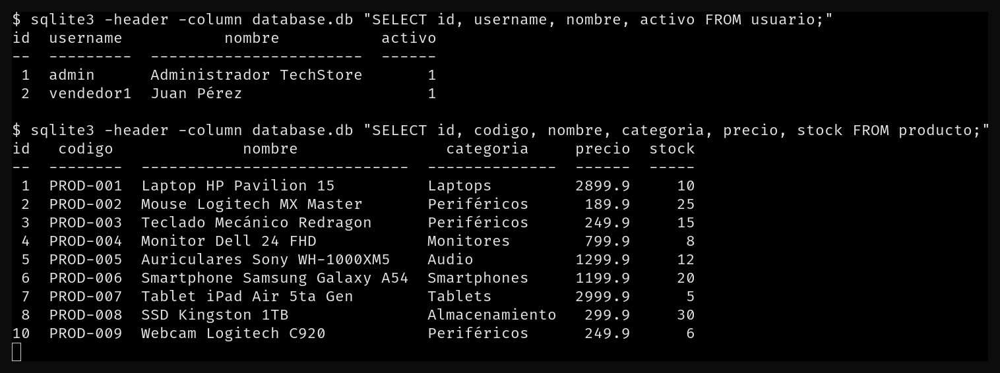{width=15.5cm}

## Pruebas de endpoints

- POST /api/login: credenciales válidas, 200.
- POST /api/login: contraseña incorrecta, 401.
- POST /api/login: datos incompletos, 400.
- GET /api/productos: lista de productos, 200.
- GET /api/productos/buscar?q=laptop: coincidencia por nombre, 200.
- GET /api/productos/buscar?q=xyz123: sin coincidencias, 200.
- POST /api/productos: registro de producto, 201.
- POST /api/productos: código duplicado, 409.
- PUT /api/productos/{id}: edición de producto, 200.
- DELETE /api/productos/{id}: baja de producto, 200.
- GET /health: estado del servicio, 200.

Pruebas con pytest: 15 aprobadas de 15.

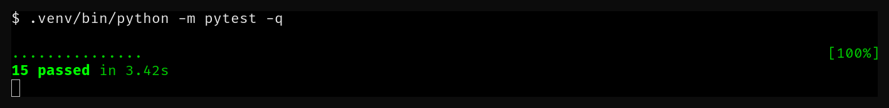{width=15.5cm}

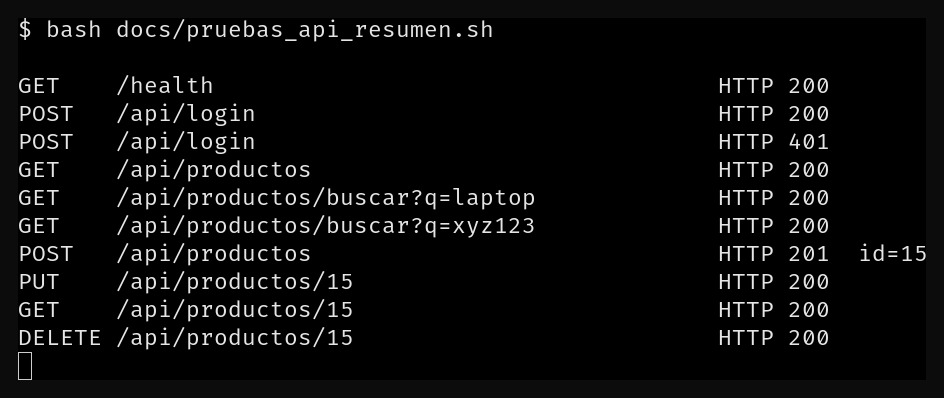{width=15.5cm}

## Aplicación

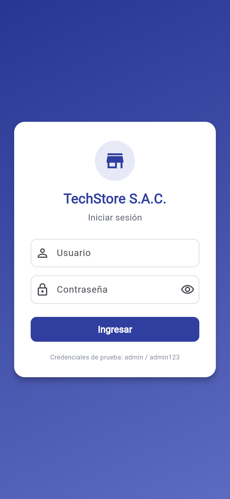{width=6.2cm}

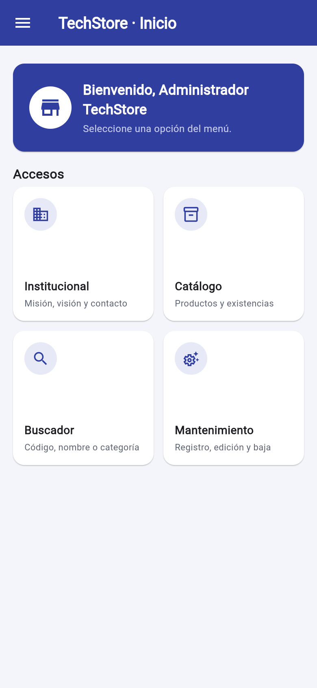{width=6.2cm}

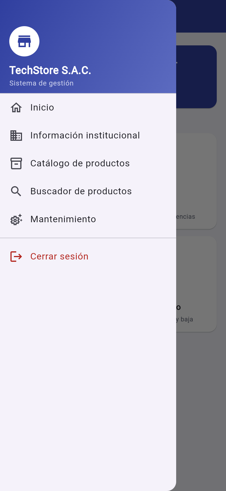{width=6.2cm}

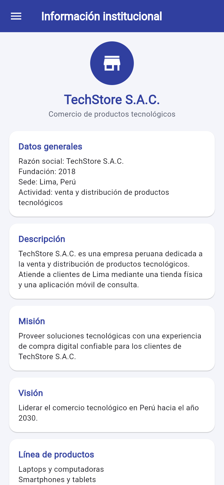{width=6.2cm}

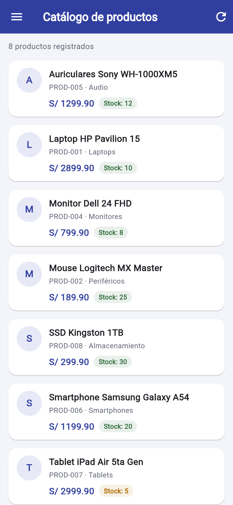{width=6.2cm}

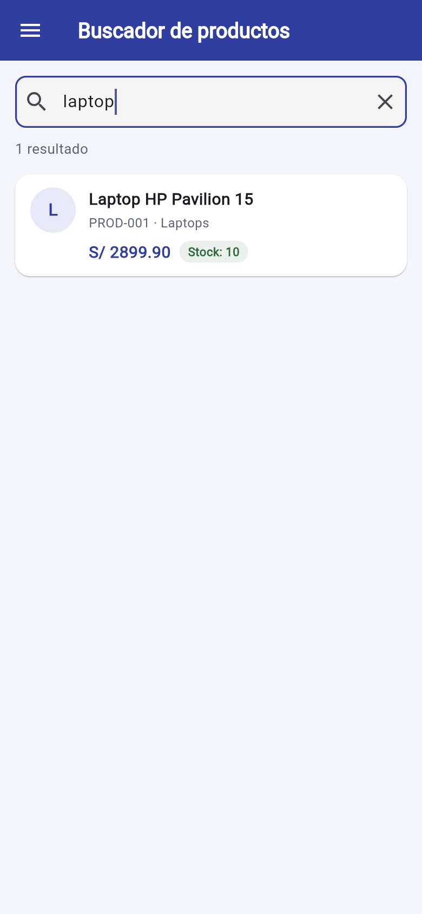{width=6.2cm}

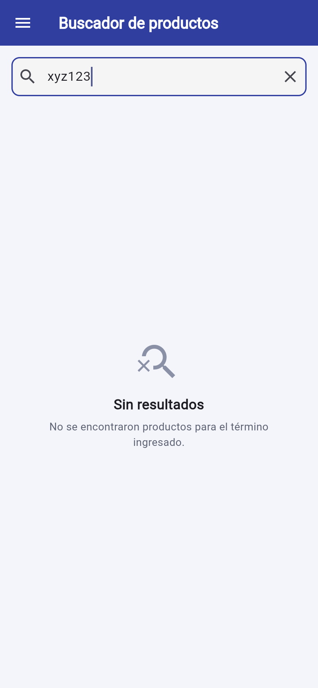{width=6.2cm}

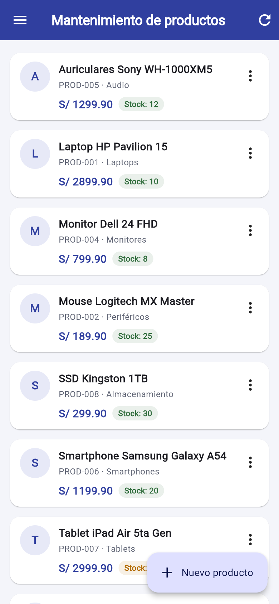{width=6.2cm}

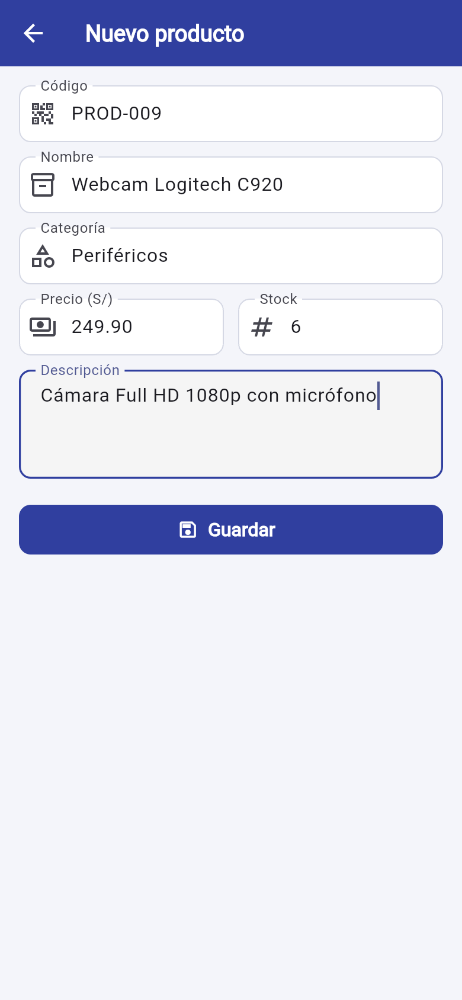{width=6.2cm}

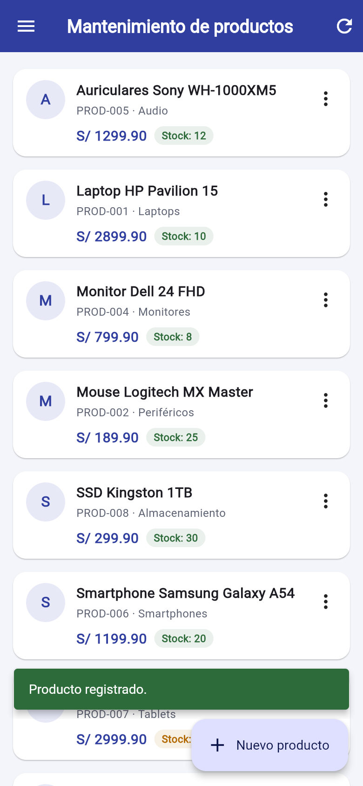{width=6.2cm}

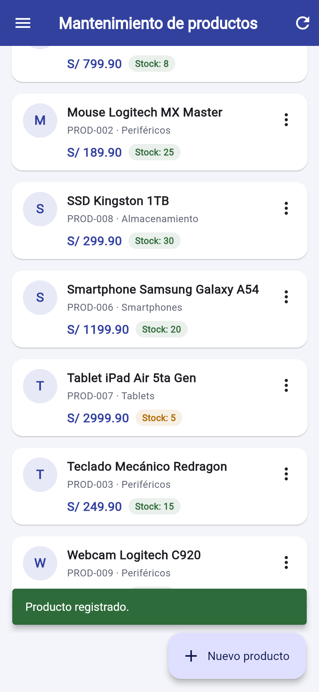{width=6.2cm}

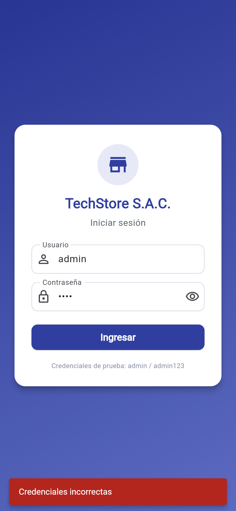{width=6.2cm}

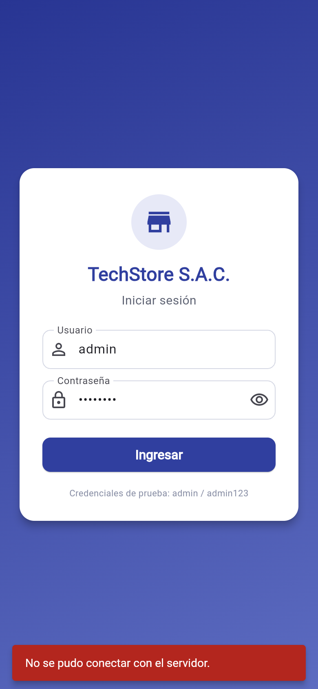{width=6.2cm}

## Capturas del despliegue

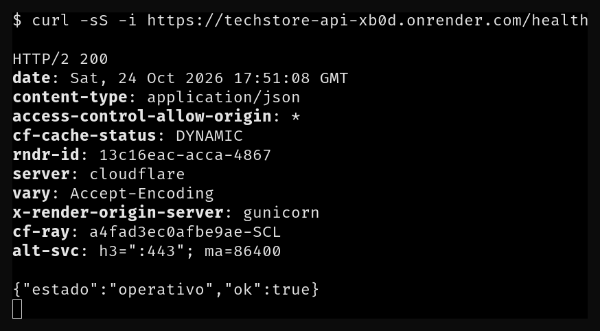{width=15.5cm}

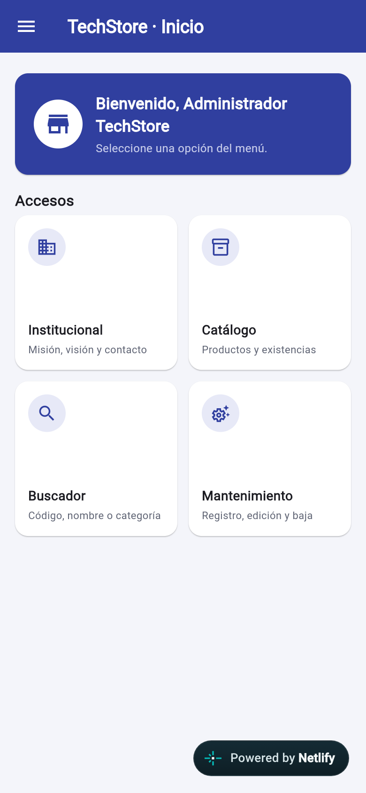{width=6.2cm}

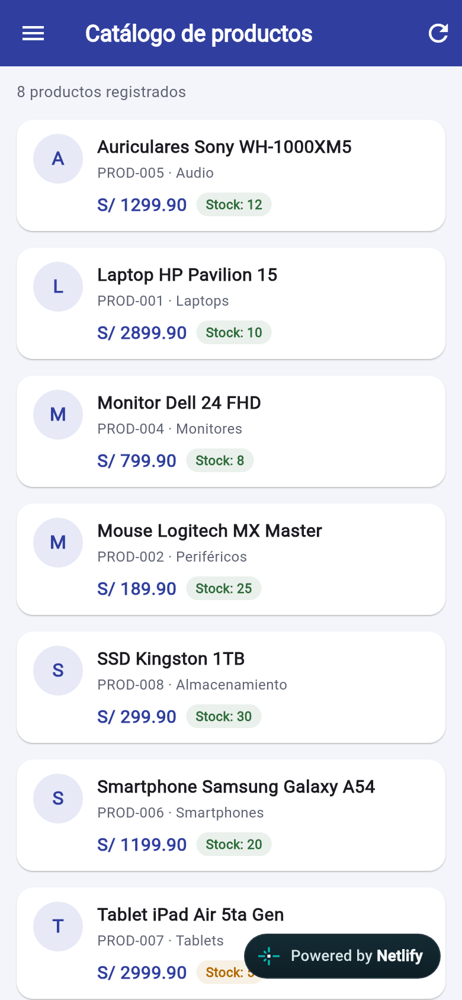{width=6.2cm}
